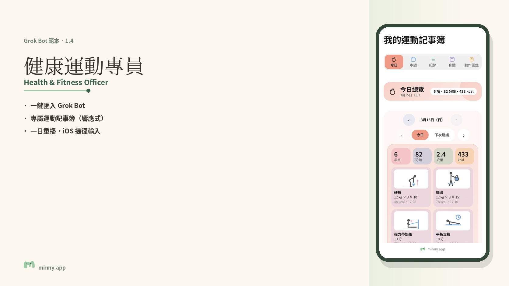
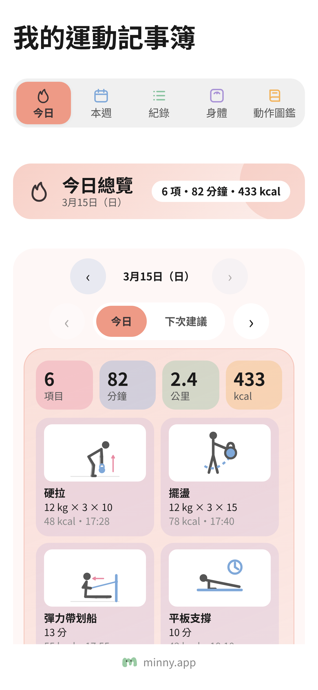
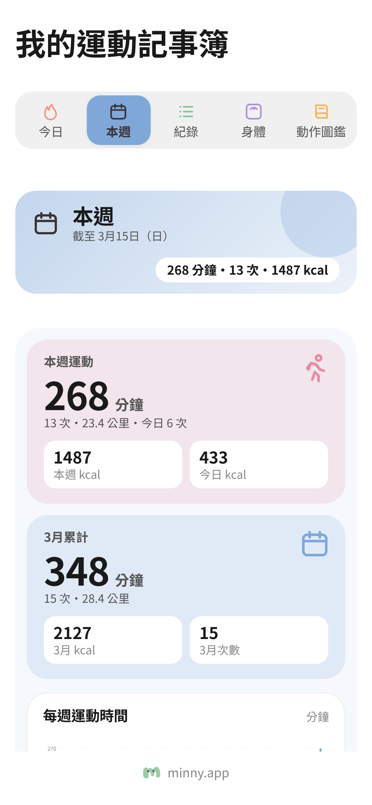
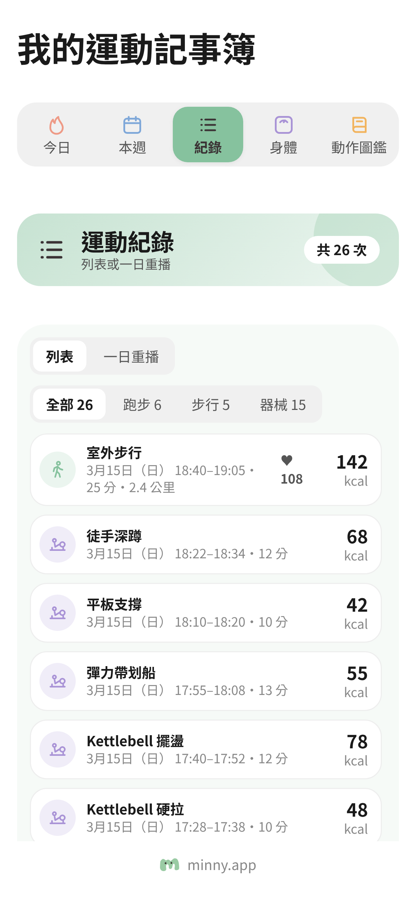
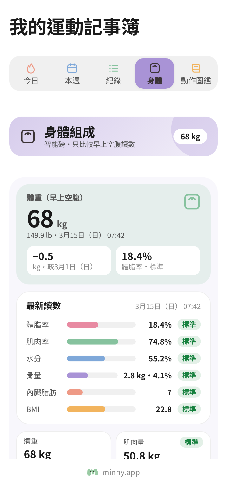
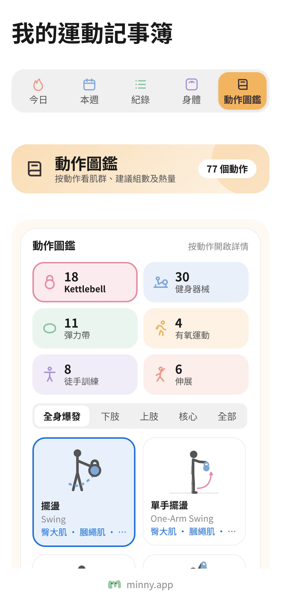
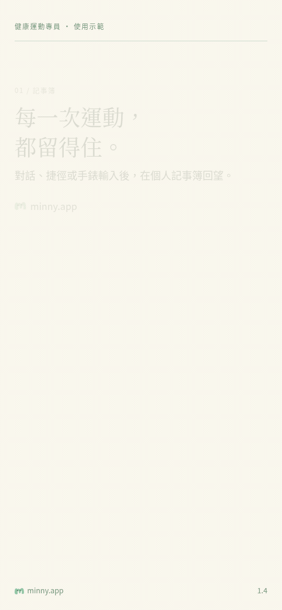
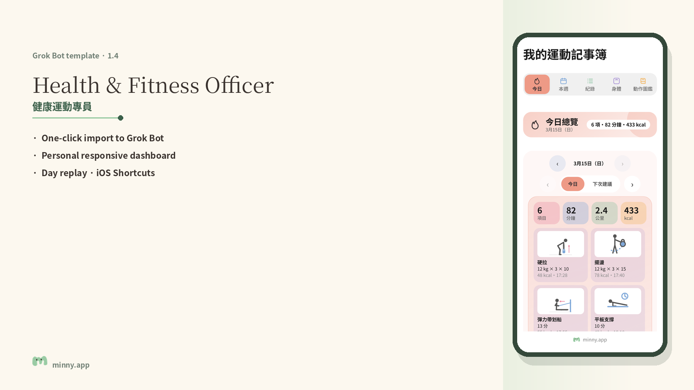

# 健康運動專員／Health & Fitness Officer

Grok Bot 範本：記錄每次運動、估算熱量，並在一節運動結束後一次過給你總結與建議；附運動記事簿（一日重播、肌肉圖、動作圖鑑、熱量計算機）。

範本連結：https://x.ai/bot/J1NkLBCjiVQHKmoNXkFrO

<!-- 品牌資料卡：由 Claude 填寫 -->



## 功能

- **安靜記錄**：對話、iPhone 捷徑、Android HTTP Shortcuts 或健康 app 匯入；不逐項推送通知，約 30–45 分鐘無新記錄後才一併總結。
- **運動記事簿**：今日、本週、紀錄（含一日重播）、身體與動作圖鑑；響應式版面，手機、平板與電腦皆可閱讀。
- **熱量估算**：按 ACSM、Concept2、MET 等標準方法估算；數字僅供參考，不屬醫療建議。
- **可選 Notion**：記錄可存於你自己的 Notion 資料庫，或記事簿 Page／本機 CSV。
- **主選單**：每次回覆後可開啟個人 Dashboard、記錄運動、檢查更新或更多功能；更新不會刪除你的記錄。

## 如何匯入

1. 打開範本連結：https://x.ai/bot/J1NkLBCjiVQHKmoNXkFrO  
2. 按指示加入你的 bot 團隊。  
3. 首次對話會問語言（中文／English），其後完成記錄方式與首次設定。

本倉庫的 `skills/` 與 `src/` 對應範本內容，方便閱讀與再發佈；日常使用請直接匯入範本。

## 主選單

| 選項 | 說明 |
|---|---|
| 📊 個人 Dashboard | 開啟運動記事簿 |
| 🏃 記錄運動 | 以對話或捷徑記錄 |
| 🔄 查看有沒有新版本 | 比對範本「版本：X.Y」 |
| ⚙️ 更多功能 | 增刪運動、捷徑、自動同步、頭像等 |

## 畫面預覽

畫面使用虛構示範數據，並非任何真實帳號。

| 今日 | 本週 | 紀錄 |
|---|---|---|
|  |  |  |

| 身體 | 動作圖鑑 |
|---|---|
|  |  |



另附英文封面：

## 倉庫結構

```
skills/                 八份技能（中／英 × 開始使用、捷徑、肌肉圖、後備記錄）
src/dashboard_demo.tsx  記事簿示範畫面程式（虛構數據）
src/kit.tsx             輕量畫布元件（見 STAGESHOW_LICENSE_MIT.txt）
src/webhook_payload.md  運動 webhook 欄位說明
src/exercises.demo.json 示範動作清單
docs/images/            預覽圖與示意動畫
brand/                  m.svg；BRAND.md／TRADEMARK.md 另行提供後放入
LICENSE                 MIT
```

路徑寫成 bot 電腦上的 `workout-tracker/`；匯入 Grok Bot 後按技能說明使用。記錄只存於閣下帳戶。版本： 1.4。

## 授權

程式碼採用 MIT 授權，見 [LICENSE](LICENSE)。

`src/kit.tsx` 衍生自 stageshow 畫布套件，另見 [src/STAGESHOW_LICENSE_MIT.txt](src/STAGESHOW_LICENSE_MIT.txt)。

**minny.app 名稱及 m 字標不屬開源授權範圍**，說明見 `brand/TRADEMARK.md`（由 Claude 另行提供後放入 `brand/`）。`brand/` 最終只應含 `m.svg`、`BRAND.md`、`TRADEMARK.md`；放入後請刪除 `brand/PLACEHOLDER.txt`。

---

## English

**Health & Fitness Officer** is a Grok Bot template that logs each workout, estimates calories, and sends one combined summary after a session — with a workout notebook (day replay, muscle map, exercise library, calorie calculator).

Template: https://x.ai/bot/J1NkLBCjiVQHKmoNXkFrO

### Features

- **Quiet logging** — chat, iPhone Shortcut, Android HTTP Shortcuts or health-app export; no per-entry notifications; one combined summary after about 30–45 minutes with no new entry.
- **Workout notebook** — Today, This Week, Records (with Day Replay), Body and Exercise Library; responsive on phone, tablet and desktop.
- **Calorie estimates** — ACSM, Concept2, MET and related methods; figures are estimates, not medical advice.
- **Optional Notion** — store rows in your own Notion database, or use the notebook Page / local CSV.
- **Main menu** — after each reply: Personal Dashboard, log a workout, check for updates, or more; updates never delete your records.

### Import

Open the template link above and add it to your team. The first chat asks for language, then logging preferences and first-time setup.

### Licence

Code is MIT (see [LICENSE](LICENSE)).

`src/kit.tsx` is derived from the stageshow canvas kit; see [src/STAGESHOW_LICENSE_MIT.txt](src/STAGESHOW_LICENSE_MIT.txt).

The **minny.app name and m mark are not covered** by that licence; see `brand/TRADEMARK.md` (supplied separately). The `brand/` folder should end up with only `m.svg`, `BRAND.md` and `TRADEMARK.md` — delete `brand/PLACEHOLDER.txt` after those files are added.

Screenshots and the demo animation use fictional data only. Records stay in your own account. Version: 1.4.

---

[minny.app](https://minny.app)
